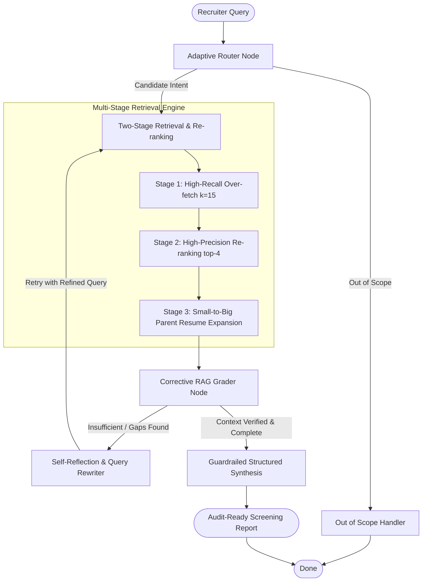

# 🎯 TalentGraph: Agentic Resume Screening & Candidate Evaluation Engine

[](https://www.python.org/)
[](https://www.langchain.com/)
[](https://www.langchain.com/langgraph)
[](https://docs.pydantic.dev/)
[](https://opensource.org/licenses/MIT)

> **TalentGraph** is a production-grade **Agentic Retrieval-Augmented Generation (RAG)** system designed to evaluate candidate resumes with zero hallucinations, complete pool coverage, and self-correcting query reflection.

---

## 📌 The Problem with Naive RAG in Recruitment

Standard semantic search (Naive RAG) breaks down when applied to candidate vetting:

```
Recruiter Query ──> [Vector Search (Top-k Chunks)] ──> [LLM Prompt] ──> [Output]
```

1. **Information Fragmentation:** Career summaries and project achievements reside in different parts of a resume. Top-$k$ chunking retrieves one and misses the other.
2. **Pool Coverage Blindspot:** Fixed top-$k$ similarity returns 4 chunks from the same 2 candidates, silently omitting dozens of other qualified applicants in the pool.
3. **Ungrounded Hallucinations:** Plain LLMs invent plausible salary expectations, relocation willingness, or certifications when data is absent.

---

## 🏗️ TalentGraph Architecture

TalentGraph solves these vulnerabilities through a multi-tier, self-correcting state machine built on **LangGraph**:



---

## ✨ Key Architectural Innovations

### 1. Small-to-Big Retrieval (Parent Document Pattern)
*Search small, synthesize big.* We split documents into focused 800-character chunks for precise vector matching, but trace matches back to full candidate resumes before LLM synthesis. This completely eliminates internal document fragmentation.

### 2. Guardrailed Structured Outputs with Mandatory Unknowns
Using Pydantic schemas, every assessment must supply:
- `match_score` (0-10 fit score)
- `evidence` (verbatim quote backing the score)
- `unknowns` (mandatory reporting of missing attributes, forbidding speculation)

### 3. Two-Stage Retrieval (Re-ranking)
Vector cosine distance is only a proxy for relevance. We over-fetch 15 candidate chunks and pass them through a second-stage cross-scoring pass to filter out superficial keyword matches and surface exact hands-on technical experience.

### 4. Adaptive Query Routing
An intelligent classifier analyzes the recruiter's prompt to choose the optimal flow:
- `single_candidate_lookup`: Targeted deep-dive on a named candidate.
- `candidate_comparison`: Side-by-side contrast of specific candidates.
- `pool_screening`: Broad capability filter across the entire candidate pool.
- `out_of_scope`: Graceful handling of non-recruitment queries.

### 5. Corrective RAG (CRAG) & Self-Reflection
An evaluation node grades whether retrieved evidence is sufficient to answer the prompt. If facts are missing, the query rewriter reformulates the search parameters and triggers a second targeted retrieval pass automatically.

---

## 📊 Benchmark Comparison

| Feature / Metric | Naive RAG | Small-to-Big RAG | Reranked RAG | **TalentGraph (Agentic RAG)** |
| :--- | :---: | :---: | :---: | :---: |
| **Context Fragmentation** | ❌ Fails (chunks split) | ✅ **Resolved** | ✅ **Resolved** | ✅ **Resolved** |
| **Hallucination Protection** | ❌ None (Hallucinates) | ⚠️ Weak | ⚠️ Moderate | ✅ **Strict (Pydantic Unknowns)** |
| **Technical Skill Precision** | ⚠️ Low (Cosine proxy) | ⚠️ Moderate | ✅ **High** | ✅ **Very High** |
| **Query Routing** | ❌ None (Rigid top-$k$) | ❌ None | ❌ None | ✅ **Adaptive Intent Classifier** |
| **Self-Reflection & Recovery** | ❌ None | ❌ None | ❌ None | ✅ **Active (CRAG Grader + Rewriter)** |
| **Out-of-Scope Safety** | ❌ Hallucinates context | ❌ Hallucinates context | ❌ Hallucinates context | ✅ **Guarded via Router** |

---

## 🚀 Quickstart

### Prerequisites
- Python 3.11 or higher
- OpenAI API Key

### Installation

Clone the repository and install dependencies with `uv` (recommended) or `pip`:

```bash
# Clone repository
git clone https://github.com/your-username/talentgraph-agentic-rag.git
cd talentgraph-agentic-rag

# Install with UV
uv sync

# Or with pip
pip install -r requirements.txt
```

### Configuration

Create a `.env` file in the project root:

```bash
cp .env.example .env
```

Add your OpenAI API key:
```ini
OPENAI_API_KEY=sk-...
```

---

## 💻 Usage

### 1. Interactive Jupyter Notebook Walkthrough
Run the full educational walkthrough step-by-step:
```bash
jupyter notebook notebooks/agentic_resume_screening_rag.ipynb
```

### 2. Command Line Interface (CLI)
Run real-time candidate screening queries from the terminal:

```bash
python main.py --query "Which candidate has hands-on experience with automated mobile testing and Selenium?"
```

Sample CLI output:
```text
================ FINAL SCREENING REPORT ================
Executive Summary: Identified strong automated test automation engineering candidates specializing in mobile and web automation frameworks.

• Candidate: Gautami Bulusu (Match Score: 9/10)
  Key Evidence: "Architected mobile automated testing suites using Appium and Selenium WebDriver. Conducted cross-platform testing on Android and iOS devices."
  Identified Gaps/Unknowns: Cloud infrastructure exposure not explicitly stated in profile.

• Candidate: Sougandh (Match Score: 8/10)
  Key Evidence: "Implemented end-to-end automated test suites using Selenium WebDriver and TestNG for mission-critical web applications."
  Identified Gaps/Unknowns: Mobile-specific testing frameworks not listed.
```

---

## 📁 Repository Structure

```
agentic-resume-rag/
├── README.md                                  # Production documentation
├── pyproject.toml                             # Packaging & dependencies
├── requirements.txt                           # Pip requirements
├── .env.example                               # Environment template
├── .gitignore                                 # Git hygiene
├── main.py                                    # CLI Runner
├── notebooks/
│   └── agentic_resume_screening_rag.ipynb     # Flagship step-by-step notebook
├── resumes/                                   # 25 multi-domain candidate PDF resumes
└── src/
    ├── __init__.py                            # Package exports
    ├── schemas.py                             # Pydantic models & state contracts
    ├── loader.py                              # Resume PDF extractor & catalog
    ├── retriever.py                           # Small-to-big & reranking engine
    └── agent.py                               # LangGraph multi-node state machine
```

---

## 📄 License
This project is licensed under the MIT License — see the [LICENSE](LICENSE) file for details.
